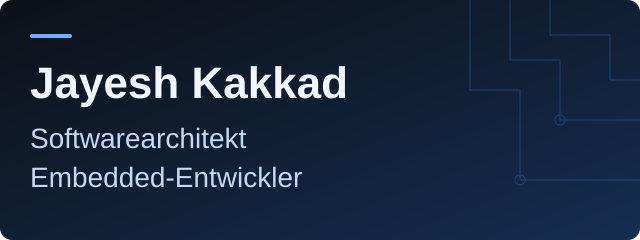

[English](README.md) · **Deutsch**

**Sichere, skalierbare Plattformen an der Schnittstelle zwischen Embedded-Hardware und moderner Software.**

[Portfolio ↗](https://www.jayesh-kakkad.de/de/) · [LinkedIn ↗](https://www.linkedin.com/in/jayesh-kakkad) · [E-Mail ↗](mailto:contact@jayesh-kakkad.com)

[Über mich](#über-mich) · [Entwicklung](#was-ich-entwickle) · [Werkzeuge](#technologien) · [Lehre](#mentoring--lehre)

## Über mich

Ich arbeite an Embedded-Firmware, Backend-Systemen und industriellen Kameraplattformen. Dabei betrachte ich den gesamten Weg vom Gerät und seinen Daten bis zur nützlichen, wartbaren Software.

Neben meiner Entwicklungsarbeit unterrichte ich ehrenamtlich an der [ReDI School of Digital Integration](https://www.redi-school.org/) und vermittle praktische Kenntnisse in Programmierung und Cybersicherheit.

**Themen für einen Austausch:** V4L2- und GStreamer-Pipelines, SvelteKit, IoT-Sicherheit und Systemarchitektur.

## Was ich entwickle

### 01 / Plattformarchitektur
Sichere industrielle IoT-Plattformen, die Orchestrierung von Edge-Geräten, verteilte Dienste und die Integration betrieblicher Abläufe.

### 02 / Embedded-Entwicklung
Embedded Linux mit Yocto und PTXdist, Videopipelines mit V4L2 und GStreamer sowie Software für ZynqMP- und ARM-Plattformen.

### 03 / Full-Stack-Entwicklung
Oberflächen mit SvelteKit, React und TypeScript; APIs und Datenhaltung mit FastAPI, Node.js, PostgreSQL und Prisma. Selbst gehostete Bereitstellung mit Docker.

### 04 / Security Engineering
Bedrohungsmodellierung, sichere Entwicklung und praktische Sicherheitstests. Zu meinen Werkzeugen gehören Burp Suite, Nessus, Wireshark und die Kali-Toolchain.

## Technologien

**Programmiersprachen**

**Frontend & Backend**

**Daten & Infrastruktur**

Werkzeuge für Embedded-Entwicklung und Sicherheit

**Embedded:** Embedded Linux · Yocto · PTXdist · V4L2 · GStreamer · C / C++

**Sicherheit:** OWASP Top 10 · OWASP IoT Top 10 · Bedrohungsmodellierung · Burp Suite · Nessus · Wireshark

## Meine Arbeit entdecken

Die vollständige Sammlung: Projektkontext auf meiner Website, Quellcode auf GitHub.

[Zum Projektkatalog ↗](https://www.jayesh-kakkad.de/de/projects/) · [Repositories entdecken ↗](https://github.com/JayeshKakkad-Rotoclear?tab=repositories)

GitHub-Aktivität und Statistiken

## Mentoring & Lehre

**Ehrenamtlicher Dozent · [ReDI School of Digital Integration](https://www.redi-school.org/)**

Grundlagen der Programmierung, Cybersicherheit und praktische technische Problemlösung. Ich möchte komplexe Themen verständlich machen und Lernende dabei unterstützen, durch eigene Erfahrungen sicherer zu werden.

## Inhalte & Lernen

[**Cyberfolio Chronicles ↗**](https://www.youtube.com/@Cyberfolio_Chronicles) — praktische Übungen zu Cybersicherheit, Cloud-Sicherheit und Embedded Systems.

Tutorials und Übungen entdecken (Englisch)

| Video | Thema |
|-------|-------|
| [File Integrity Monitor with PowerShell](https://youtu.be/uDd5R2uEIL0) | Dateiintegrität selbst überwachen |
| [Cloud-based Home Lab with AWS](https://youtu.be/xh2xLN_uBlE) | Infrastruktur für ein Sicherheitslabor |
| [Live RDP Brute Force Detection — Azure Sentinel](https://www.youtube.com/watch?v=yU_YuGYtJGU) | SIEM und Bedrohungserkennung |
| [Ransomware PoC (C#)](https://youtu.be/dab8pQ5UVjs) | Funktionsweise von Ransomware verstehen |
| [Vulnerability Management with Nessus Essentials](https://youtu.be/mnjxUoBTyKs) | Praktische Schwachstellenanalyse |

---

### Kontakt

Interesse an Embedded Systems, Plattformarchitektur oder sicherer Entwicklung? Ich freue mich auf den Austausch.

[contact@jayesh-kakkad.com](mailto:contact@jayesh-kakkad.com) · [LinkedIn](https://www.linkedin.com/in/jayesh-kakkad) · [Website](https://www.jayesh-kakkad.de/de/)
