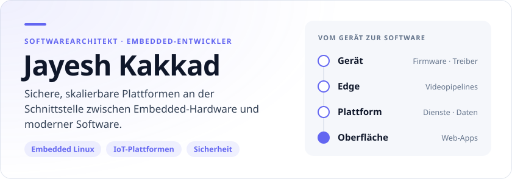
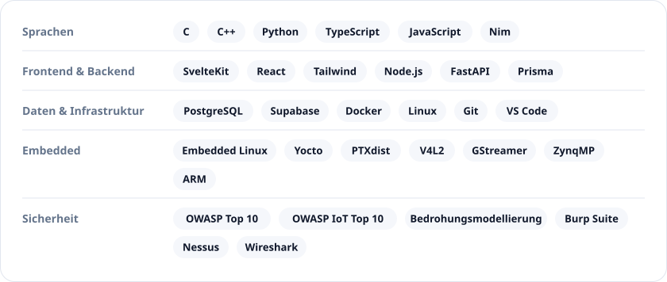
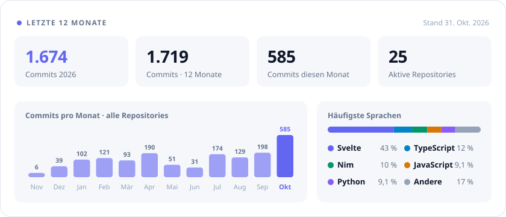

[English](README.md) · **Deutsch**

<picture>
  <source media="(prefers-color-scheme: dark)" srcset="assets/cards/hero-de-dark.svg">
  
</picture>

[Portfolio ↗](https://www.jayesh-kakkad.de/de/) · [LinkedIn ↗](https://www.linkedin.com/in/jayesh-kakkad) · [E-Mail ↗](mailto:contact@jayesh-kakkad.com)

[Über mich](#über-mich) · [Entwicklung](#was-ich-entwickle) · [Werkzeuge](#technologien) · [Aktivität](#github-aktivität) · [Lehre](#mentoring--lehre)

## Über mich

Ich arbeite an Embedded-Firmware, Backend-Systemen und industriellen Kameraplattformen. Dabei betrachte ich den gesamten Weg vom Gerät und seinen Daten bis zur nützlichen, wartbaren Software.

Neben meiner Entwicklungsarbeit unterrichte ich ehrenamtlich an der [ReDI School of Digital Integration](https://www.redi-school.org/) und vermittle praktische Kenntnisse in Programmierung und Cybersicherheit.

**Themen für einen Austausch:** V4L2- und GStreamer-Pipelines, SvelteKit, IoT-Sicherheit und Systemarchitektur.

## Was ich entwickle

<picture>
  <source media="(prefers-color-scheme: dark)" srcset="assets/cards/focus-de-dark.svg">
  
</picture>

## Technologien

<picture>
  <source media="(prefers-color-scheme: dark)" srcset="assets/cards/stack-de-dark.svg">
  
</picture>

## GitHub-Aktivität

<picture>
  <source media="(prefers-color-scheme: dark)" srcset="assets/cards/stats-de-dark.svg">
  
</picture>

Ausführliche GitHub-Statistiken

## Meine Arbeit entdecken

Die vollständige Sammlung: Projektkontext auf meiner Website, Quellcode auf GitHub.

[Zum Projektkatalog ↗](https://www.jayesh-kakkad.de/de/projects/) · [Repositories entdecken ↗](https://github.com/JayeshKakkad-Rotoclear?tab=repositories)

## Mentoring & Lehre

**Ehrenamtlicher Dozent · [ReDI School of Digital Integration](https://www.redi-school.org/)**

Grundlagen der Programmierung, Cybersicherheit und praktische technische Problemlösung. Ich möchte komplexe Themen verständlich machen und Lernende dabei unterstützen, durch eigene Erfahrungen sicherer zu werden.

## Inhalte & Lernen

[**Cyberfolio Chronicles ↗**](https://www.youtube.com/@Cyberfolio_Chronicles) — praktische Übungen zu Cybersicherheit, Cloud-Sicherheit und Embedded Systems.

Tutorials und Übungen entdecken (Englisch)

| Video | Thema |
|-------|-------|
| [File Integrity Monitor with PowerShell](https://youtu.be/uDd5R2uEIL0) | Dateiintegrität selbst überwachen |
| [Cloud-based Home Lab with AWS](https://youtu.be/xh2xLN_uBlE) | Infrastruktur für ein Sicherheitslabor |
| [Live RDP Brute Force Detection — Azure Sentinel](https://www.youtube.com/watch?v=yU_YuGYtJGU) | SIEM und Bedrohungserkennung |
| [Ransomware PoC (C#)](https://youtu.be/dab8pQ5UVjs) | Funktionsweise von Ransomware verstehen |
| [Vulnerability Management with Nessus Essentials](https://youtu.be/mnjxUoBTyKs) | Praktische Schwachstellenanalyse |

---

### Kontakt

Interesse an Embedded Systems, Plattformarchitektur oder sicherer Entwicklung? Ich freue mich auf den Austausch.

[contact@jayesh-kakkad.com](mailto:contact@jayesh-kakkad.com) · [LinkedIn](https://www.linkedin.com/in/jayesh-kakkad) · [Website](https://www.jayesh-kakkad.de/de/)
