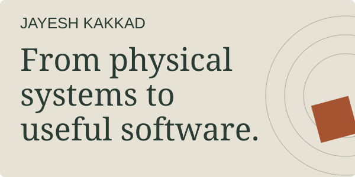
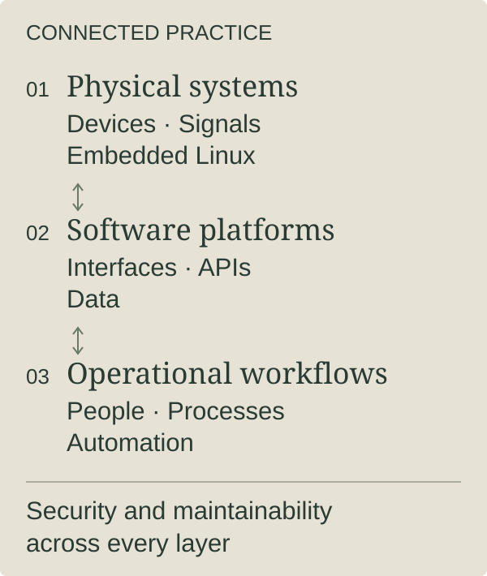

**English** · [Deutsch](README.de.md)

  

I connect embedded engineering, software platforms and the workflows around them. My work spans industrial camera systems, production planning and independent technical experiments.

[Portfolio ↗](https://www.jayesh-kakkad.de/en/) · [Email ↗](mailto:contact@jayesh-kakkad.com) · [LinkedIn ↗](https://www.linkedin.com/in/jayesh-kakkad)

## Where my work connects

  

I am interested in the connections: how a device becomes part of a platform, how information reaches the right person, and how software fits into everyday operations.

The layers in detail

- **Physical systems:** devices, signals and embedded Linux.
- **Software platforms:** interfaces, APIs and data.
- **Operational workflows:** people, processes and automation.

Security and maintainability belong at every layer.

## Explore at your own pace

Browse the project catalogue for context, or explore the repositories for code and documentation.

[Project catalogue ↗](https://www.jayesh-kakkad.de/en/projects/) · [Browse repositories ↗](https://github.com/JayeshKakkad-Rotoclear?tab=repositories)

## How I work

Understand the real workflow. Make system boundaries explicit. Build something maintainable. Explain the decisions.

Technical toolkit

- **Embedded:** C/C++, embedded Linux, V4L2 and GStreamer.
- **Platforms:** TypeScript, Svelte, Python and PostgreSQL.
- **Integration and operations:** Docker, APIs and secure-by-design architecture.

Teaching and explorations

I volunteer as an instructor at [ReDI School of Digital Integration](https://www.redi-school.org/). Through [Cyberfolio Chronicles](https://www.youtube.com/@Cyberfolio_Chronicles), I share hands-on security learning.

Sharing knowledge is part of how I practise engineering.

---

### Have a system worth making better?

Let's talk about embedded systems, software architecture and digital operations.

[contact@jayesh-kakkad.com ↗](mailto:contact@jayesh-kakkad.com)
